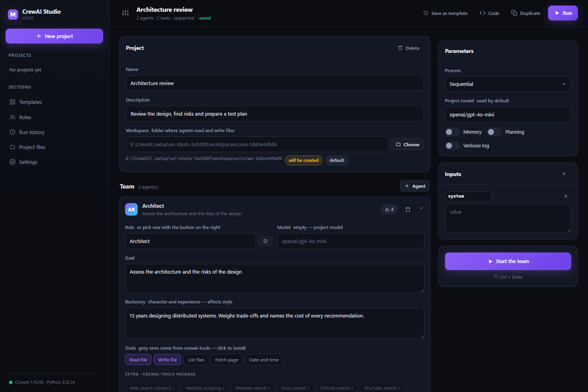
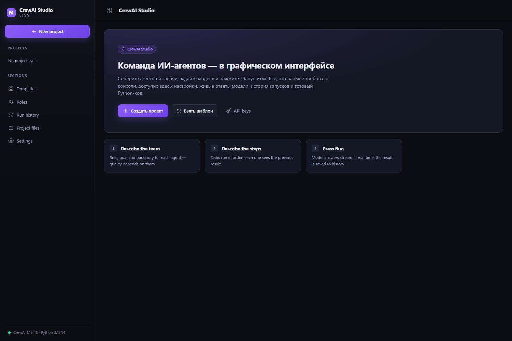
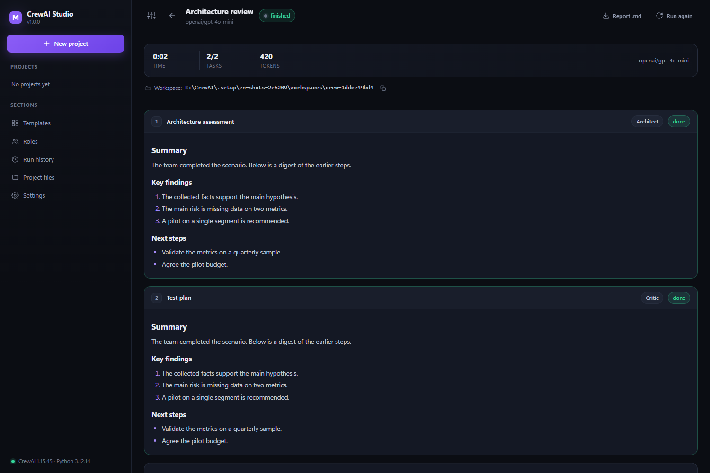
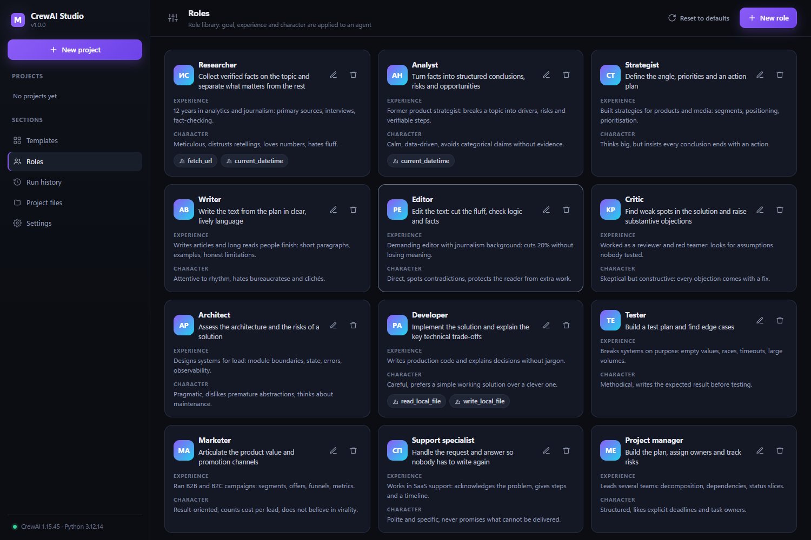
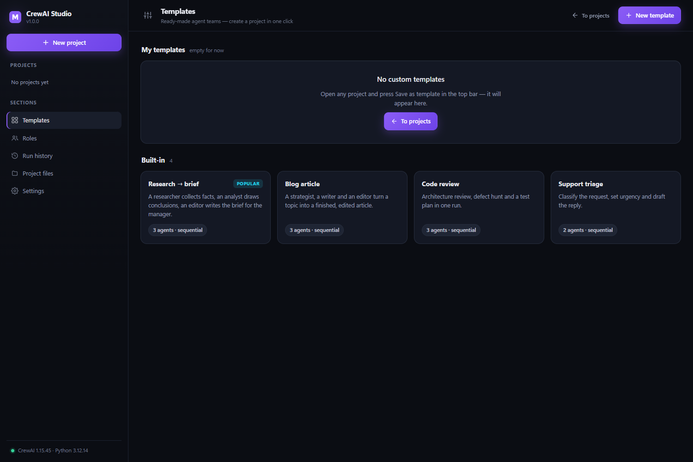
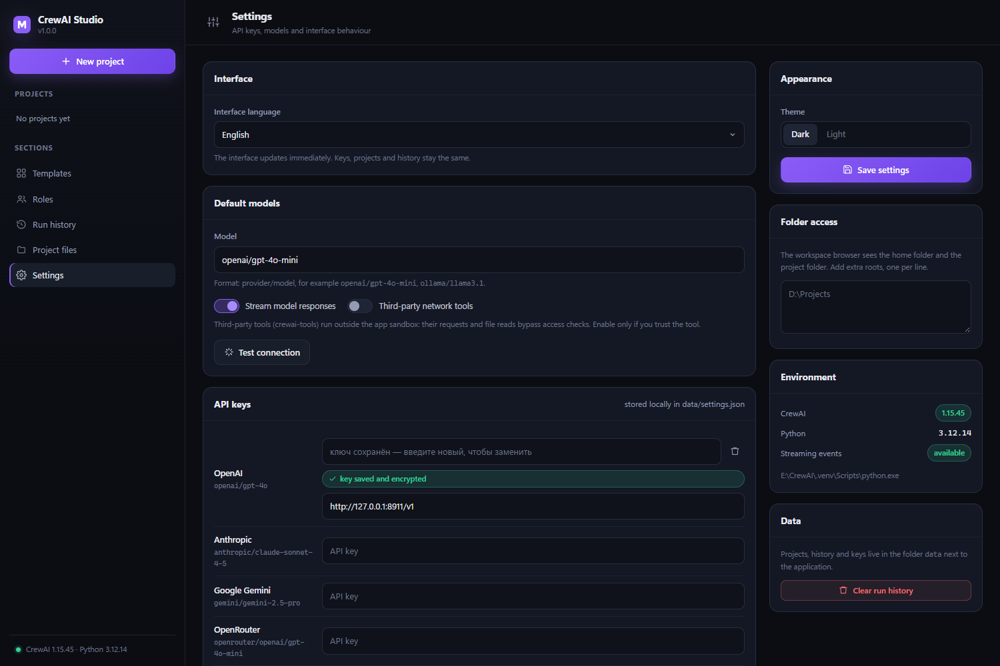
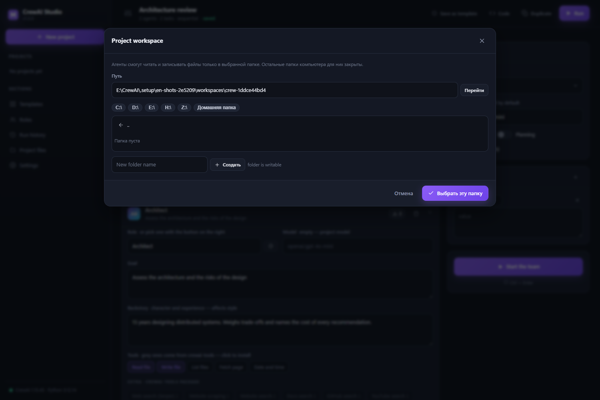
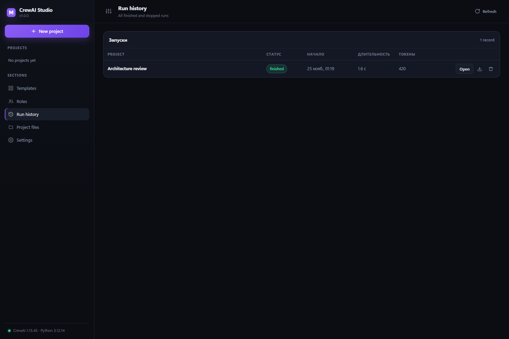

# CrewAI Studio

A local desktop-style GUI for [CrewAI](https://crewai.com): build teams of AI agents,
run them and watch the agent steps in real time — no console, no YAML, no Python
editing.



## Features

- **Team builder** — agents (role, goal, backstory, model, tools) and tasks (description,
  expected output, assignee, context, output format) in ordinary forms.
- **Project workspace** — every project has its own folder on disk; agents read and write
  only there. Pick it with the built-in folder browser, create a new one, or keep the default.
  For another drive the browser offers **Allow this folder**, which saves the root in settings.
- **Access requests that wait** — when an agent needs a file outside the workspace, the run
  pauses and you choose: allow once, allow until the run ends, or deny. No answer in five
  minutes closes the request.
- **Change confirmation** — per-agent switch: every file write asks you first, or the agent
  works automatically.
- **Background runs** — leave the project and the run keeps going; an indicator brings you back.
- **Role library** — 12 built-in roles (researcher, analyst, editor, architect, critic and more).
  Pick a role and goal, experience, character and tools are filled in. Roles are editable.
- **Custom templates** — save a project as a template, apply it in one click, rename or delete.
- **Per-agent limits** — max iterations and a time limit; the run log prints the effective values first.
- **Live run** — agent steps per task, tool calls, timing and token usage (raw model tokens are not streamed).
- **Stop and detach** — stop at the nearest step; if the model hangs, the run is marked as
  force-stopping after 12 seconds, and Detach frees the slot immediately.
- **History** — every run is kept with results and tokens; open it, export `.md`/`.json`, delete.
- **Keys and models** — OpenAI, Anthropic, Gemini, OpenRouter, DeepSeek, Groq, Ollama,
  LM Studio and any OpenAI-compatible server; connection test in one click.
- **Encrypted keys** — API keys are never stored as plain text (Windows DPAPI) and never
  returned to the browser.
- **Generated Python** — the Code button shows a script that reproduces the run.
- **English and Russian UI** — switch the interface language in Settings; the interface
  re-renders immediately.

## Screenshots

| | |
|---|---|
|  |  |
| First launch | Team builder |
|  |  |
| Live run | Role library |
|  |  |
| Templates | Settings |
|  |  |
| Workspace picker | Run history |

## Quick start

1. Install [Python 3.10–3.13](https://www.python.org/downloads/) (tick **Add python.exe to PATH**).
2. Double-click `start.bat`.

On the first launch the script creates `.venv`, installs CrewAI (a few minutes, needs internet)
and opens `http://127.0.0.1:7860`.

Then:

1. **Settings → API keys** — paste a provider key and press Test connection.
2. **Settings → Default models** — e.g. `openai/gpt-4o-mini`.
3. **New project** or **Templates** → fill agents and tasks → **Run**.
4. In an agent card press the star next to the role to fill goal and backstory from the library.
5. Save a good project as a template with **Save as template**.
6. Pick the project **workspace** — the folder agents read and write.

> Model format is `provider/model`. Local options: `ollama/llama3.1`,
> `openai/local-model` with Base URL `http://localhost:1234/v1`.

## Documentation

Full documentation is available in Russian and English:

| Document | English | Русский |
|---|---|---|
| User guide | [docs/en/user-guide.md](docs/en/user-guide.md) | [docs/user-guide.md](docs/user-guide.md) |
| Architecture | [docs/en/architecture.md](docs/en/architecture.md) | [docs/architecture.md](docs/architecture.md) |
| REST API and SSE | [docs/en/api.md](docs/en/api.md) | [docs/api.md](docs/api.md) |
| Security | [docs/en/auth.md](docs/en/auth.md) | sign-in, accounts, forced password change, session lifetime, recovery |
| [docs/en/logging.md](docs/en/logging.md) | `data/logs`, response codes, `error_id`, run logs, diagnostics |
| [docs/en/security.md](docs/en/security.md) | [docs/security.md](docs/security.md) |
| Tests | [docs/en/testing.md](docs/en/testing.md) | [docs/testing.md](docs/testing.md) |
| Troubleshooting | [docs/en/troubleshooting.md](docs/en/troubleshooting.md) | [docs/troubleshooting.md](docs/troubleshooting.md) |
| Changelog | [CHANGELOG.md](CHANGELOG.md) | |

## How it works

- `app/server.py` — HTTP transport (REST, SSE, static files, session token, Host/Origin checks).
- `app/runner.py` — one run at a time, events, permissions, cancel/detach, checkpoints.
- `app/spec.py` — project schema, validation, placeholders, Python code generation.
- `app/workspace.py` — workspace policy: allowed roots, service directories, folder browser.
- `app/tools.py` — 5 sandboxed built-in tools; third-party network tools are opt-in.
- `app/store.py` — JSON storage, encrypted secrets, run index.
- `web/` — vanilla JS UI (no build step), `web/i18n.js` for RU/EN.

More detail: [docs/en/architecture.md](docs/en/architecture.md).

## Tests

15 suites, no tokens spent: a local OpenAI-compatible mock replaces the provider.

```bat
.venv\Scripts\python.exe tests\test_runner_e2e.py
.venv\Scripts\python.exe tests\test_http_api.py
.venv\Scripts\python.exe tests\test_features_api.py
.venv\Scripts\python.exe tests\test_workspace_api.py
.venv\Scripts\python.exe tests\test_permissions_api.py
.venv\Scripts\python.exe tests\test_tools_install.py
.venv\Scripts\python.exe tests\test_cancel.py
.venv\Scripts\python.exe tests\test_hardening.py
.venv\Scripts\python.exe tests\test_round4.py
.venv\Scripts\python.exe tests\test_braced_text.py
.venv\Scripts\python.exe tests\test_ui.py
.venv\Scripts\python.exe tests\test_ui_features.py
.venv\Scripts\python.exe tests\test_ui_workspace.py
.venv\Scripts\python.exe tests\test_ui_confirmations.py
.venv\Scripts\python.exe tests\test_ui_i18n.py
```

Browser suites need Chrome (`pip install playwright`). See [docs/en/testing.md](docs/en/testing.md).

## Security

- Listens on `127.0.0.1` only; remote access is refused.
- Host/Origin checks, a per-session token and `application/json` only.
- Static files only from `web/`; path traversal is rejected.
- Workspace policy applies on save and on run; service folders are forbidden.
- Third-party tools are disabled by default and ask permission for every network call.

Details and residual risks: [docs/en/security.md](docs/en/security.md).

## Where data lives

Projects `data/crews`, history `data/runs`, roles `data/roles.json`, custom templates
`data/templates`, workspaces `data/workspaces`, uploads/outputs `data/uploads` and
`data/outputs`, settings and keys `data/settings.json` (keys encrypted), logs `data/logs`.

## Compatibility

- Windows 10/11, Python 3.10–3.13, CrewAI 1.15+ (tested on 1.15.45).
- macOS/Linux: `python3 -m venv .venv && .venv/bin/pip install -r requirements.txt && .venv/bin/python run.py`.

## License

Application code is MIT. CrewAI is distributed under its own MIT license and is a
separate project.
