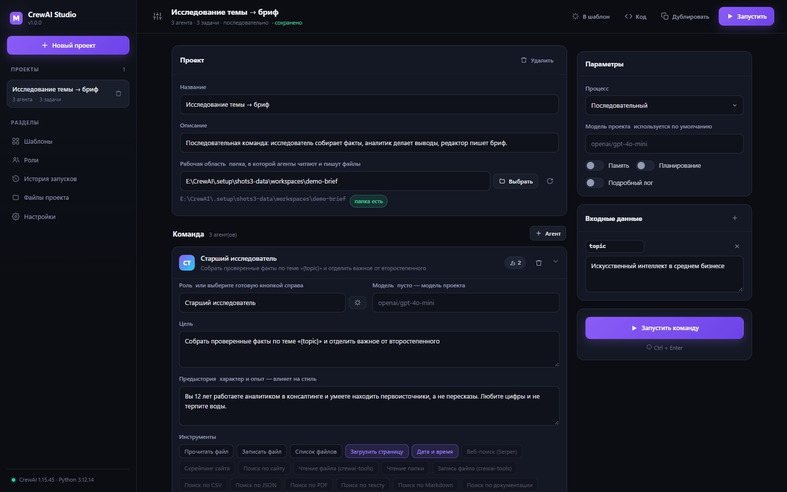
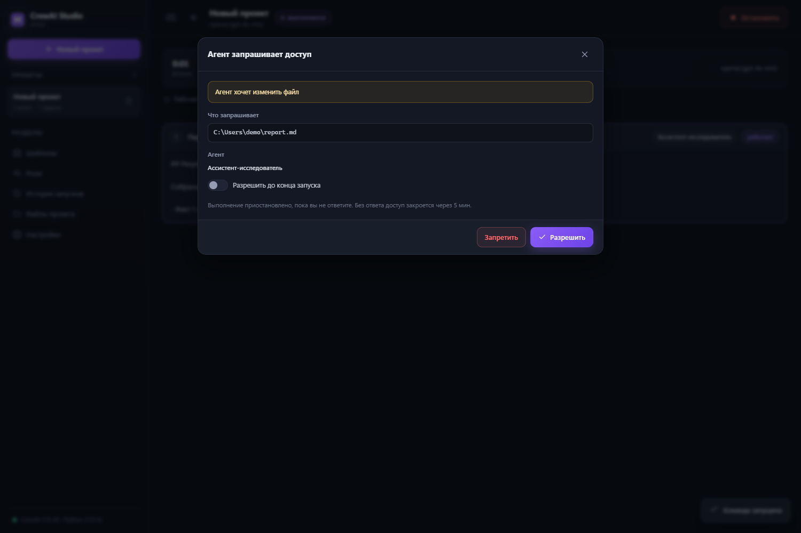
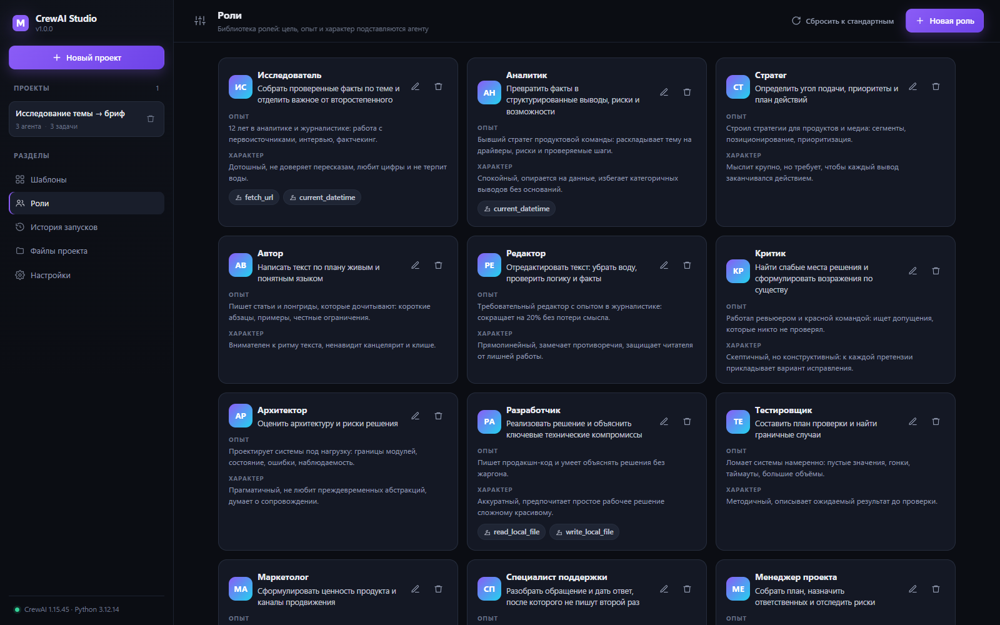
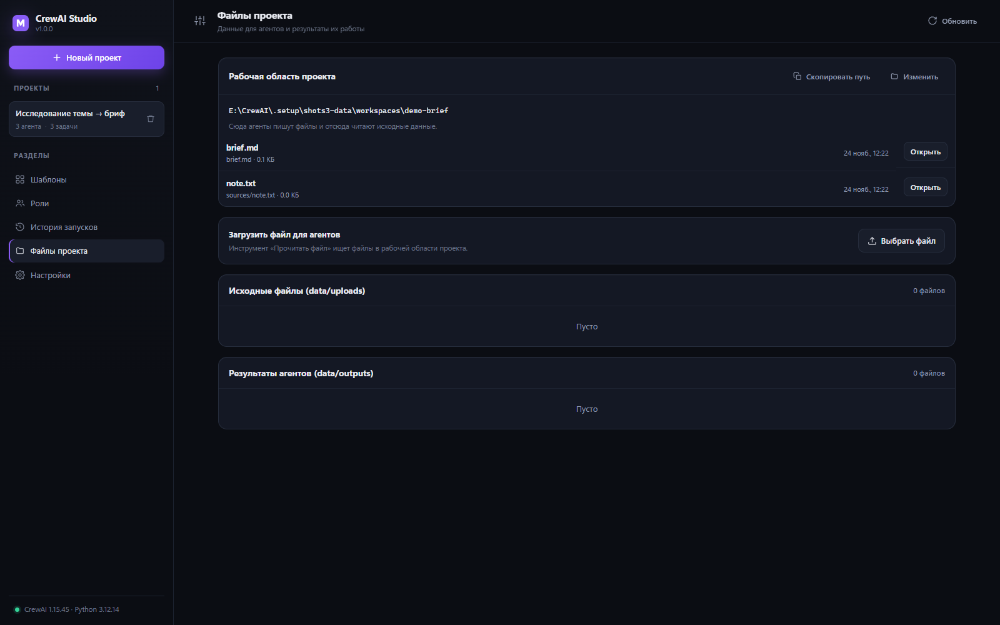
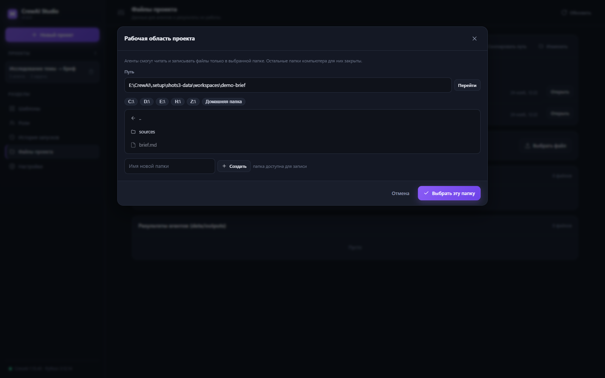
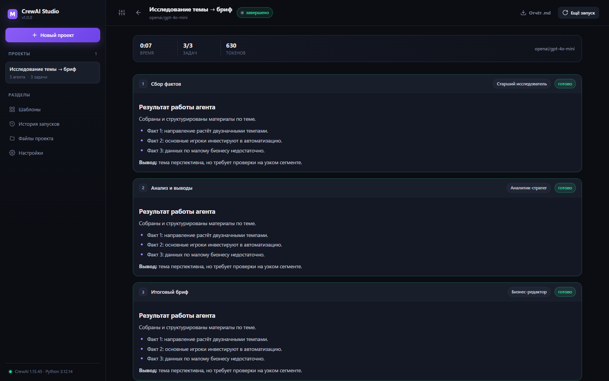
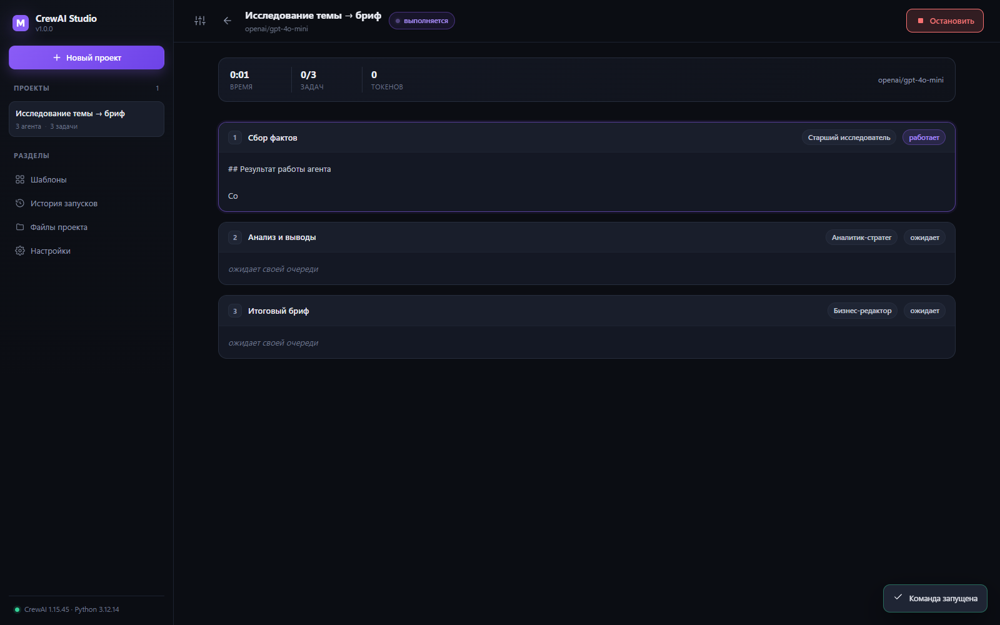
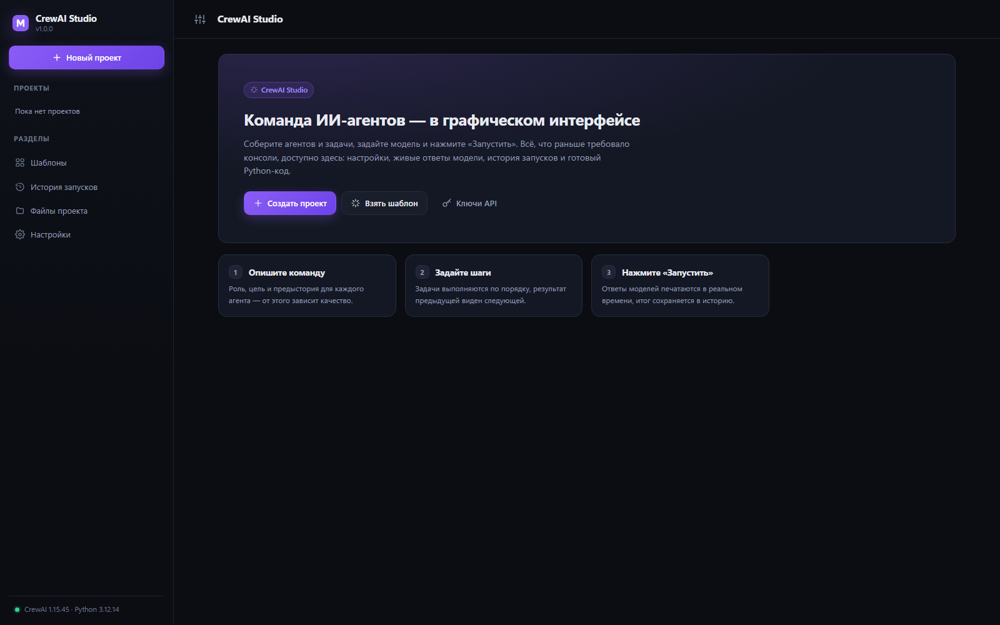
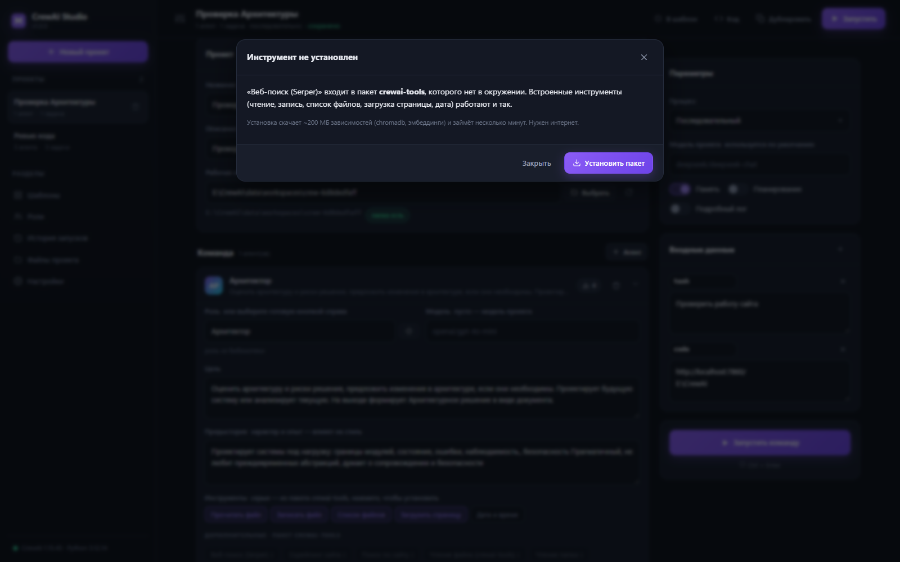

# CrewAI Studio

[English version](README.en.md) · [Документация на английском](docs/en/user-guide.md)

Локальный графический интерфейс для [CrewAI](https://crewai.com): собирайте команды ИИ-агентов, запускайте их и смотрите ответы моделей в реальном времени — без консоли, YAML-файлов и правок Python-кода.



## Что умеет

- **Конструктор команды** — агенты (роль, цель, предыстория, модель, инструменты) и задачи (описание, ожидаемый результат, исполнитель, контекст, формат вывода) в обычных формах.
- **Рабочая область проекта** — у каждого проекта своя папка на диске: агенты читают и пишут файлы только в ней. Папку можно выбрать встроенным проводником, создать новую или оставить папку по умолчанию.
- **Запрос доступа с ожиданием** — если агенту нужен файл за пределами рабочей области, выполнение встаёт на паузу, а вам приходит вопрос: разрешить один раз, до конца запуска или запретить. Без ответа доступ закрывается по таймауту.
- **Подтверждение изменений** — флаг на агенте: включён — каждая запись файла подтверждается вами, выключен — агент работает автоматически.
- **Фоновые запуски** — уйдя из проекта, вы не теряете выполнение: внизу слева висит индикатор «выполняется», который возвращает на экран прогресса (в том числе после перезагрузки страницы).
- **Библиотека ролей** — 12 готовых ролей (исследователь, аналитик, редактор, архитектор, критик и другие). Выбрали роль — цель, опыт, характер и инструменты подставились агенту. Роли можно создавать, редактировать и удалять.
- **Свои шаблоны** — проект сохраняется как шаблон кнопкой «В шаблон» или через «Новый шаблон» в разделе «Шаблоны»; шаблон можно переименовать, применить к новому проекту и удалить.
- **Язык интерфейса** — русский и английский; переключатель в настройках, интерфейс перерисовывается сразу, выбор сохраняется.
- **Лимиты на агента** — «Макс. итераций» и «Лимит времени, с» ограничивают, сколько шагов и секунд агент может потратить; в начале запуска в журнал пишутся действующие параметры.
- **Управление проектами** — создание, дублирование и удаление (в верхней панели проекта или значком корзины в списке слева).
- **Живой запуск** — ответы моделей печатаются по мере генерации, по каждой задаче отдельно; видно вызовы инструментов, время и расход токенов.
- **Остановка** — кнопка «Остановить» переводит запуск в «останавливается…» и освобождает интерфейс: если модель или инструмент не реагируют, запуск принудительно снимается через 12 секунд, можно сразу запускать новый.
- **История** — все запуски сохраняются с результатами и токенами; можно открыть, скачать отчёт `.md`/`.json` или удалить.
- **Готовые команды** — четыре стандартных сценария (исследование → бриф, статья, ревью кода, разбор обращений) создаются в один клик.
- **Ключи и модели** — OpenAI, Anthropic, Gemini, OpenRouter, DeepSeek, Groq, Ollama, LM Studio и любой OpenAI-совместимый сервер; проверка подключения одной кнопкой.
- **Ключи зашифрованы** — API-ключи не хранятся открытым текстом (Windows DPAPI) и никогда не возвращаются в браузер: интерфейс видит только «ключ сохранён».
- **Готовый Python-код** — кнопка «Код» показывает скрипт, который воспроизводит запуск в консоли.
- **Файлы проекта** — загрузка данных для агентов и просмотр результатов, которые они записали.
- **Дополнительные инструменты** — серые инструменты из пакета `crewai-tools` ставятся кнопкой прямо в интерфейсе, без командной строки.
- **Настройки** в интерфейсе: тёмная/светлая тема, потоковая передача, дополнительные переменные окружения.

Запрос доступа: выполнение приостановлено, пока вы не ответите.





Рабочая область проекта — папка, в которой агенты читают и пишут файлы:



Выбор папки встроенным проводником (диски, подпапки, создание новой папки):





Во время работы видно, как модель печатает ответ по каждой задаче:



Стартовый экран при первом запуске:



## Быстрый старт

1. Установите [Python 3.10–3.13](https://www.python.org/downloads/) (при установке отметьте **Add python.exe to PATH**).
2. Дважды щёлкните `start.bat`.

При первом запуске скрипт создаст окружение `.venv`, поставит CrewAI (несколько минут, нужен интернет) и откроет браузер на `http://127.0.0.1:7860`.

Дальше:

1. **Настройки → Ключи API** — вставьте ключ провайдера и нажмите «Проверить подключение».
2. **Настройки → Модели по умолчанию** — укажите модель, например `openai/gpt-4o-mini`.
3. **Новый проект** или **Шаблоны** → заполните агентов и задачи → **Запустить**.
4. В карточке агента нажмите кнопку со звёздочкой рядом с ролью — выберите роль из библиотеки, и цель с предысторией заполнятся сами.
5. Понравившийся проект сохраните как шаблон: **«В шаблон»** в верхней панели.
6. В карточке «Проект» выберите **рабочую область** — папку, где агенты будут читать и сохранять файлы (по умолчанию `data/workspaces/<проект>`).

> Модель указывается в формате `провайдер/модель`. Локальные варианты: `ollama/llama3.1`, `openai/local-model` со «Базовым URL» вида `http://localhost:1234/v1`.

## Документация

| Документ | О чём |
|---|---|
| [docs/user-guide.md](docs/user-guide.md) | полное руководство: проекты, агенты, задачи, роли, шаблоны, рабочая область, запуск, подтверждения, настройки |
| [docs/architecture.md](docs/architecture.md) | как устроено внутри: слои, модули, жизненный цикл запуска, события, хранение, политика путей |
| [docs/api.md](docs/api.md) | REST API и SSE: эндпоинты, тела запросов, коды ошибок, пример запуска из скрипта |
| [docs/security.md](docs/security.md) | модель доверия, что закрыто, остаточные риски и рекомендации |
| [docs/testing.md](docs/testing.md) | 15 наборов тестов: что покрывают и как запускать |
| [docs/troubleshooting.md](docs/troubleshooting.md) | частые ошибки и что делать |
| [CHANGELOG.md](CHANGELOG.md) | история версий |

## Ручной запуск

```bat
.venv\Scripts\python.exe run.py                 :: http://127.0.0.1:7860
.venv\Scripts\python.exe run.py --port 8080 --no-browser
```

Без предварительной установки:

```bat
python -m venv .venv
.venv\Scripts\python.exe -m pip install -r requirements.txt
.venv\Scripts\python.exe run.py
```

## Как это устроено

```
run.py                вход в приложение (порт, браузер)
app/config.py         пути, провайдеры, настройки по умолчанию
app/store.py          хранение проектов, истории и настроек (JSON)
app/spec.py           нормализация, проверка и код-превью спецификации
app/roles.py          библиотека ролей: цель, опыт, характер, инструменты
app/workspace.py      рабочая область проекта: выбор папки, проверки, листинг
app/secrets.py        шифрование ключей (Windows DPAPI / Fernet)
app/templates.py      стандартные и пользовательские шаблоны проектов
app/runner.py         сборка Agent/Task/Crew и запуск с потоком событий
app/crewai_env.py     переносит служебные данные CrewAI внутрь проекта
app/tools.py          встроенные инструменты + опциональные из crewai-tools
app/server.py         HTTP API, Server-Sent Events, статика
web/                  интерфейс: index.html, app.js, styles.css
data/                 проекты, роли, шаблоны, история, файлы, ключи
tests/                мок-модель и пятнадцать наборов тестов
```

Запуск использует штатные объекты CrewAI: `Agent`, `Task`, `Crew`, `Process`. Прогресс берётся из шины событий CrewAI (`crewai.events`) и из потокового вывода (`Crew(stream=True)`), поэтому интерфейс показывает не только финальный ответ, но и то, что происходит внутри задачи.

### API (если нужна интеграция)

| Метод | Путь | Назначение |
|---|---|---|
| `GET` | `/api/info`, `/api/status` | окружение, версия CrewAI, активный запуск |
| `GET/POST` | `/api/crews` | список / создание (в т. ч. `{"template": "research-brief"}`) |
| `GET/PUT/DELETE` | `/api/crews/{id}` | чтение, сохранение, удаление |
| `POST` | `/api/crews/{id}/validate` | проверка перед запуском |
| `GET` | `/api/crews/{id}/code` | сгенерированный Python-скрипт |
| `GET/POST` | `/api/roles` | библиотека ролей (создание новой) |
| `PUT/DELETE` | `/api/roles/{id}` | редактирование и удаление роли |
| `POST` | `/api/roles/reset` | вернуть стандартный набор ролей |
| `GET/PUT` | `/api/crews/{id}/workspace` | рабочая область проекта: `{"path": "D:\\Проект"}` |
| `GET` | `/api/fs?path=...` | содержимое папки для встроенного проводника |
| `POST` | `/api/fs/mkdir` | создать папку: `{"parent": "...", "name": "..."}` |
| `GET/POST` | `/api/templates` | стандартные + свои шаблоны; `{"crew_id","title","description"}` сохраняет проект как шаблон |
| `PUT/DELETE` | `/api/templates/{key}` | переименовать / удалить свой шаблон |
| `POST` | `/api/runs` | запуск: `{"crew_id": "...", "inputs": {...}}` |
| `GET` | `/api/runs/{id}/events` | поток событий (SSE) |
| `POST` | `/api/runs/{id}/permissions/{req}` | ответ на запрос доступа: `{"allow": true, "scope": "once\|run"}` |
| `POST` | `/api/runs/{id}/cancel` | остановка |
| `POST` | `/api/runs/{id}/detach` | отсоединить зависший запуск и освободить слот |
| `GET` | `/api/runs/active` | идентификатор активного запуска |
| `GET` | `/api/tools` | каталог инструментов: `available`, `policy`, `warning` |
| `GET/POST` | `/api/tools/install` | состояние установки `crewai-tools` и её запуск |
| `GET/POST` | `/api/files` | список файлов рабочей области и загрузка файла |
| `GET` | `/api/runs/{id}/export?format=md\|json` | отчёт |
| `GET/PUT` | `/api/settings` | ключи, модель, поведение |

## Тесты

```bat
.venv\Scripts\python.exe tests\test_runner_e2e.py        :: реальный CrewAI + мок-модель
.venv\Scripts\python.exe tests\test_http_api.py          :: REST, SSE, история, экспорт
.venv\Scripts\python.exe tests\test_features_api.py      :: роли, шаблоны, удаление проектов
.venv\Scripts\python.exe tests\test_workspace_api.py     :: рабочая область, проводник, файлы
.venv\Scripts\python.exe tests\test_permissions_api.py   :: запросы доступа, шифрование ключей
.venv\Scripts\python.exe tests\test_tools_install.py     :: установка пакета crewai-tools
.venv\Scripts\python.exe tests\test_cancel.py            :: остановка, лимиты, зависшие запуски
.venv\Scripts\python.exe tests\test_hardening.py         :: traversal, периметр, песочница, env
.venv\Scripts\python.exe tests\test_round4.py            :: R-1…R-8: workspace, сеть, env, «Код»
.venv\Scripts\python.exe tests\test_braced_text.py       :: фигурные скобки в тексте не ломают запуск
.venv\Scripts\python.exe tests\test_ui.py                :: браузер (нужен Chrome)
.venv\Scripts\python.exe tests\test_ui_features.py       :: браузер: роли, шаблоны, удаление
.venv\Scripts\python.exe tests\test_ui_workspace.py      :: браузер: выбор рабочей области
.venv\Scripts\python.exe tests\test_ui_confirmations.py  :: браузер: подтверждения, фоновый запуск
```

Тесты не тратят токены: вместо провайдера поднимается локальный OpenAI-совместимый сервер `tests/mock_llm.py`. Для браузерных тестов нужен установленный Chrome (`pip install playwright`).

## Частые вопросы

**«CrewAI не установлен».** Запустите `start.bat` (или установите вручную: `.venv\Scripts\python.exe -m pip install -r requirements.txt`).

**Ошибка авторизации модели.** Проверьте ключ и «Базовый URL» на вкладке «Настройки», затем нажмите «Проверить подключение». Для OpenRouter модель должна выглядеть как `openrouter/openai/gpt-4o-mini`.

**Нет инструментов вроде «Веб-поиск (Serper)».** Они живут в отдельном пакете `crewai-tools` и помечены в интерфейсе серым. Нажмите на такой инструмент — откроется окно с кнопкой **«Установить пакет»**: установка идёт в фоне (~200 МБ, нужен интернет), прогресс виден в окне, после успеха инструменты становятся доступны без перезапуска. Вручную то же самое:

```bat
.venv\Scripts\python.exe -m pip install "crewai-tools>=1.15,<2"
```

Серперу дополнительно нужен ключ `SERPER_API_KEY` в «Дополнительных переменных».



**Память команды.** Включается переключателем «Память» в параметрах проекта; требует эмбеддинги (обычно OpenAI), поэтому нужен рабочий ключ.

**Долгий запуск и остановка.** Ответ модели нельзя прервать мгновенно: «Остановить» прекращает работу на ближайшем шаге, а если модель или инструмент зависли — запуск снимается принудительно через 12 секунд. Чтобы запуск не растягивался, уменьшите «Макс. итераций» (8–10 обычно достаточно) и задайте «Лимит времени» на агенте; включённые «Рассуждения» добавляют отдельный запрос к модели на каждом шаге, а «Память» без ключа OpenAI отключается автоматически с предупреждением. Действующие параметры пишутся в журнал запуска первой строкой.

**Как удалить проект.** В списке слева наведите курсор на проект и нажмите корзину, либо откройте проект и нажмите «Удалить» в карточке «Проект». История запусков при этом сохраняется.

**Как сделать свой шаблон.** Откройте проект → «В шаблон» в верхней панели → название и описание. Шаблон появится в разделе «Шаблоны» → «Мои шаблоны», откуда его можно применить или удалить (корзина на карточке).

**Как изменить роль.** Раздел «Роли» → «Новая роль» или карандаш на карточке. Поля: название, цель, опыт, характер, инструменты. Уже созданным агентам роль применяется кнопкой со звёздочкой рядом с полем «Роль»; предыстория собирается из опыта и характера. Кнопка «Сбросить к стандартным» возвращает исходные 12 ролей.

**Как работают запросы доступа.** Если агенту нужен файл вне рабочей области (или включён флаг «Подтверждение изменений»), запуск приостанавливается и появляется окно с путём и причиной. Варианты: «Запретить», «Разрешить» или «Разрешить до конца запуска» (для записи разрешение запоминается на папку, для чтения — на файл). Без ответа доступ закрывается через 5 минут, а остановка запуска автоматически отменяет все ожидающие запросы.

**Как не потерять запуск.** Кнопка «К проекту» больше не останавливает выполнение: оно продолжается в фоне, а внизу слева появляется индикатор «выполняется». Нажмите его, чтобы вернуться к прогрессу; после перезагрузки страницы приложение само подхватит активный запуск. Если запуск завершится, пока вы в другом разделе, придёт уведомление с кнопкой «Открыть».

**Где хранятся ключи.** В `data/settings.json` ключи лежат зашифрованными (`enc:v1:`), ключ шифрования принадлежит вашей учётной записи Windows (DPAPI) — на другом компьютере или под другим пользователем файл бесполезен. API-ключи не возвращаются в браузер: интерфейс показывает «ключ сохранён», а пустое поле означает «не менять». Чтобы удалить ключ, нажмите корзину рядом с полем. На macOS/Linux используется Fernet с ключом `data/.secret.key` (права 0600).

**Как выбрать рабочую область.** В карточке «Проект» нажмите «Выбрать» — откроется проводник: диски, папки, кнопка «Создать» для новой папки. Кнопка «Выбрать эту папку» сохраняет выбор, рядом с полем видно итоговый путь и статус («папка есть» / «будет создана» / «нет прав на запись»).  Путь можно вписать и вручную. Если нужна папка на другом диске, проводник покажет кнопку «Разрешить эту папку»: корень сохранится в настройках, папка откроется и останется доступной. Кнопка со стрелками сбрасывает проект на папку по умолчанию — `data/workspaces/<id проекта>`.

**Запрос подтверждения у человека.** Флаг задачи `human_input` в интерфейсе отключён: CrewAI 1.15 запрашивает подтверждение только через консольный `input()`, и в графическом режиме запуск на нём зависает. Флаг сохраняется в проекте, но при запуске игнорируется (в панели проверки будет предупреждение). Сгенерированный Python-код флаг сохраняет — в консоли он работает.

**Что именно ограничено рабочей областью.** Встроенные инструменты «Прочитать файл», «Записать файл» и «Список файлов», а также задача с форматом результата «Файл» работают только внутри выбранной папки; выход за её пределы требует вашего разрешения. Загруженные через интерфейс файлы тоже попадают в рабочую область. Раздел «Файлы проекта» показывает её содержимое, а также `data/uploads` и `data/outputs` (архив старых запусков).

**Фигурные скобки в тексте.** CrewAI подставляет в описание задачи значения из «Входных данных» по шаблону `{имя}`. Если вставить в задачу текст с такими скобками (JSON, код, чужой промпт) и не объявить поле, запуск раньше падал с `Missing required template variable`. Теперь необъявленные `{имя}` остаются в тексте как есть, а объявленные подставляются; предупреждение в панели проверки показывает, какие имена встретились.

**Куда попадают результаты.** Проекты — `data/crews`, роли — `data/roles.json`, свои шаблоны — `data/templates`, история — `data/runs`, рабочие области по умолчанию — `data/workspaces`, файлы агентов — `data/uploads` и `data/outputs`, ключи — `data/settings.json` (зашифрованы), ключ шифрования для не-Windows — `data/.secret.key`. Папку `data` можно копировать целиком, но на другом аккаунте Windows зашифрованные ключи не откроются — их нужно ввести заново.

**Порты.** По умолчанию `7860`; если занят, сервер возьмёт следующий свободный и напишет адрес в консоли.

**Остановка и «Отсоединить».** Если модель или инструмент не реагируют, через 12 секунд запуск помечается «принудительно останавливается» и занимает слот до завершения потока. Кнопка «Отсоединить» освобождает слот сразу; отсоединённый поток больше не пишет файлы (даже внутри рабочей области), не ходит в сеть и не получает ответ на запрос доступа, а его ключи не затирают настройки следующего запуска.

**Безопасность.** Сервер слушает только `127.0.0.1`; удалённого доступа нет — интерфейс без пароля не выставляется в сеть. Каждый запрос проверяется по `Host` и `Origin`, все изменяющие запросы требуют одноразовый токен сессии (вставляется в страницу при загрузке) и `Content-Type: application/json` — это закрывает CSRF и DNS-rebinding. Статика отдаётся только из папки `web/`, попытки выйти за её пределы получают 403. Агентские инструменты и запись результатов задач ограничены рабочей областью; `output_file` принимается только как имя файла; рабочая папка проверяется при каждом сохранении проекта (служебные каталоги вроде `Windows\System32` и `AppData\Startup` запрещены). Запускать можно только сохранённый проект — inline-спека отклоняется. Сторонние инструменты `crewai-tools` работают вне песочницы приложения, поэтому по умолчанию выключены, включаются поимённо в настройках, а каждый их сетевой вызов спрашивает подтверждение и виден в журнале запуска. Рабочая область проверяется не только при сохранении, но и при запуске: проект, принесённый копией `data/`, со служебной папкой откатывается на папку по умолчанию с предупреждением. API-ключи хранятся зашифрованными и не отдаются в браузер; расшифровка возможна только под вашей учётной записью Windows. Дополнительные корни для проводника рабочей области задаются в настройках, а переменные окружения принимаются по allow-list (`*_API_KEY`, `*_BASE_URL`, `STUDIO_*`).

## Совместимость

- Windows 10/11, Python 3.10–3.13, CrewAI 1.15+ (проверено на 1.15.45).
- macOS/Linux: `python3 -m venv .venv && .venv/bin/pip install -r requirements.txt && .venv/bin/python run.py`.

## Лицензия

Код приложения — MIT. CrewAI распространяется по собственной лицензии MIT и является отдельным проектом.
