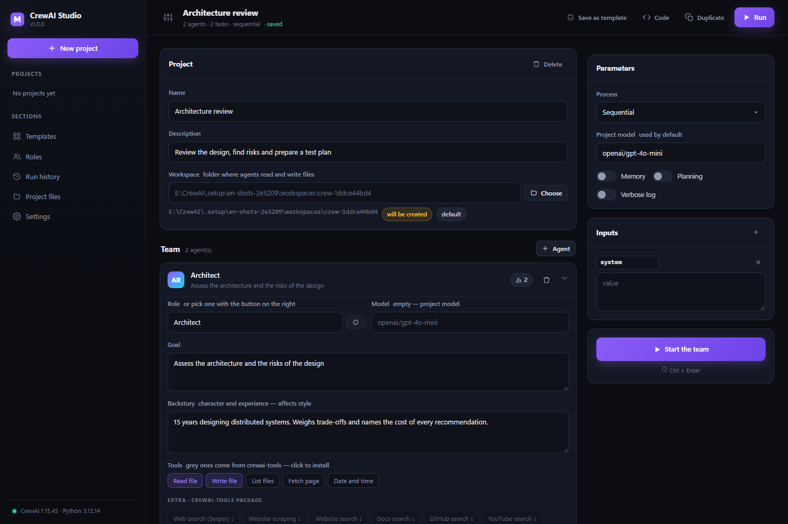
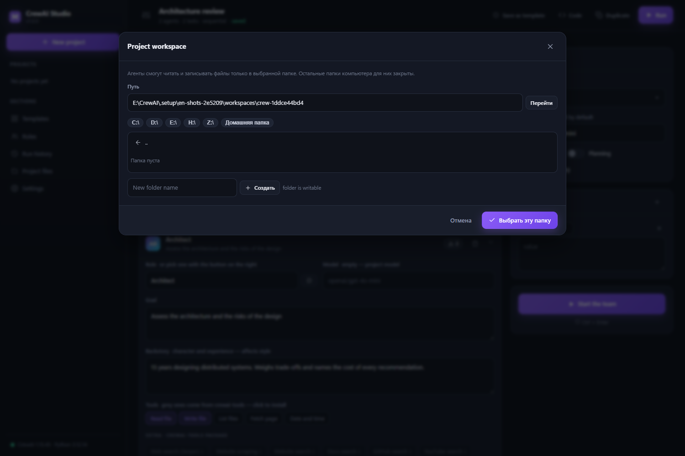
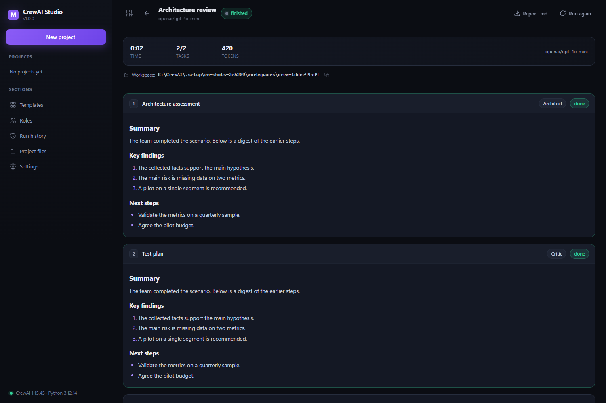
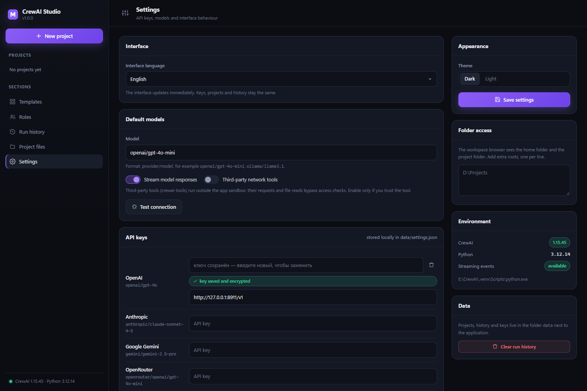

# User guide

CrewAI Studio is a local GUI for building and running CrewAI agent teams. Everything runs
on your machine: projects, history and keys live in `data/`; only model requests go out.

## Install and first launch

No-git path — the installer:

```powershell
$f = "$env:TEMP\crewai-install.ps1"
iwr https://raw.githubusercontent.com/abdyrakhman/CrewAI_GUI/main/install.ps1 -UseBasicParsing -OutFile $f
powershell -ExecutionPolicy Bypass -File $f
```

It downloads the project archive into `%LOCALAPPDATA%\CrewAI Studio`, creates `.venv`, installs
dependencies and makes a shortcut. Offline: `-Source C:\path\crewai.zip`.


1. Install Python 3.11+ (tested on 3.12). Chrome is only needed for browser tests.
2. Unpack the project, e.g. to `E:\CrewAI`.
3. Double-click `start.bat`: it creates `.venv`, installs `requirements.txt`, starts the
   server and opens `http://127.0.0.1:7860`.

First launch takes a few minutes. If port 7860 is busy, the next free port is used and
printed in the console. Manual start:

```bat
.venv\Scripts\python.exe run.py --port 7860
.venv\Scripts\python.exe run.py --no-browser
```

The server listens on `127.0.0.1` only; there is no password, so remote access is refused.



## First project

1. Press **New project**, or pick a **Template**.
2. Enter a name and description.
3. Add an agent and a task.
4. Press **Run**.

Projects save automatically about a second after an edit; the top bar shows
saved / unsaved changes / saving.

## Agents

| Field | Meaning |
|---|---|
| Role | Who the agent is. The star button fills goal, experience, character and tools from the role library. |
| Goal | What the agent achieves in this project. |
| Backstory | Experience and character: the more specific, the more predictable the behaviour. |
| Model | Empty means the project or global model. |
| Tools | File, URL and time tools the agent may use. |
| Delegation | Allow handing subtasks to other agents. |
| Confirm changes | On — every file write asks you; off — the agent writes by itself. |
| Max iterations | Steps of think → tool → observe. Default 12. |
| Time limit, s | Hard limit for the agent. `0` means no limit. |
| Reasoning | An extra model request per step: better quality, slower and more expensive. |

## Tasks

Description, expected output, assignee, context (results of earlier tasks), output format
(text, markdown, file, JSON) and, for files, a file name only — the file always goes into
the project workspace. Task order is execution order.

## Roles

The Roles section is a library: researcher, analyst, editor, architect, critic, tester and
others, each with goal, experience, character and tools. Create, edit and delete roles.
Reset restores the built-in set (your roles are deleted after a confirmation).

## Templates

A template is a saved project skeleton: agents, tasks, model, settings. Use the pencil icon to open a
template in the builder and add agents and tasks, or press **Blank template** to start from scratch. The workspace is
not part of a template — it belongs to the project. Save with **Save as template**, apply
from the Templates section, rename or delete on the card.



## Project workspace

The folder where agents read and write files; by default `data/workspaces/<project id>`.

- **Choose** opens the built-in browser (drives, folders, create folder).
- **Other drives:** pick a drive; if the folder is outside the allowed roots, the browser shows
  **Allow this folder** — one click adds the root to settings and opens it.
- **Reset** returns the default folder.
- Allowed roots: your home folder, the project folder and anything in Settings → Folder access.
  Service directories (`Windows\System32`, `Startup`, `.ssh`, `site-packages`, `app`, `web`,
  `data\crews`) cannot be chosen.

If a project was imported with a forbidden workspace, the run falls back to the default
folder and prints a warning.

**Folder permissions.** Opening a folder checks read and write access immediately: for a read-only folder the **Choose this folder** button is disabled, and saving such a workspace is rejected with an explanation.

## Inputs and curly braces

Inputs are fields substituted into task text as `{name}`. Add them in the Inputs block.

If the text contains `{something}` without a matching input, the run does not fail: the
braces stay as text and the check panel warns you. Add the field if you want substitution.

CrewAI also matches `{name}` inside doubled braces, so doubling them does not help — the
app handles it for you.



**Human confirmation.** The toggle is disabled: CrewAI asks for confirmation only in the console, so in the GUI the run used to hang on that flag. The flag stays in the project but is ignored at run time (the check panel shows a warning). The generated Python code keeps it and works in a terminal.

## Signing in

- The login and password-change pages follow the interface language setting (RU/EN).

The interface is protected by a password. On first start the administrator is created as
**admin** and a random password printed in the console and shown on the login page until you change it.
After the change the password is never displayed again.

- Sign in at `/login`; the session lives in an HttpOnly cookie (12 hours by default).
- The first sign-in with the default password opens a mandatory password change screen; until it is done
  the rest of the app and the API stay closed.
- Session lifetime is configurable in Settings → Account (1 hour — 7 days).
- **Sign out** and **Sign out everywhere** live in Settings → Account.
- After 5 failed sign-ins the login is blocked for 10 minutes.
- Change the password in Settings → Account (current, new, at least 8 characters).
- Details: [auth.md](auth.md) — sessions, roles, access recovery, and [logging.md](logging.md) — logs.
- Details: [auth.md](auth.md) — sessions, roles, access recovery.

## Running

The project is validated before a run (agents, tasks, assignees, limits, tools,
placeholders). On error the run does not start and the panel shows what to fix.

During a run you see the timer, finished tasks, token usage, task cards with status,
streamed model text, tool calls and warnings, plus Result / Per task / Log tabs.

The first log line prints effective parameters: iterations, time limit, reasoning, memory,
tool count, model.

## Access requests and confirmations

- Closing the prompt does not lose the request: the run header shows a banner
  “The run is waiting for approval” with an **Open request** button.
- Elsewhere the active-run indicator says “approval needed” — clicking it returns to the run.
- Without an answer the access request expires in 5 minutes and the run continues without it.


When an agent needs a file outside the workspace, or a write with confirmation enabled, the
run pauses and a dialog appears: what is requested, by which agent, and three buttons —
Allow, Allow until the end of the run, Deny. The folder/file shown is exactly what is
granted. Without an answer the request closes in five minutes.

Service directories are refused immediately, without a dialog.

## Stop and Detach

- **Stop** ends the run at the nearest step; the state becomes stopping.
- If the model or a tool hangs, after 12 seconds the run is marked force-stopping; the slot
  is released when the thread ends.
- **Detach** frees the slot immediately. A detached run cannot write files (even inside the
  workspace), cannot use the network and receives no permission answers.

## History and reports

- History is paginated, 50 runs per page: «Showing 1–50 of 120», Back/Next buttons and a status filter
  (completed, failed, cancelled).
- Retention is set in Settings → Run history: 30/90/180 days, a year, or “keep forever”.
  Old runs are removed at the next start; at most 5,000 records are kept.


History keeps every run: project, status, start, duration, tokens. Open a run, inspect the
events, download `.md` or `.json`, or delete it. Runs interrupted by a restart are marked
unfinished on startup.

## Project files

- A single uploaded file is limited to **16 MB**; bigger files are rejected with a clear message.
- Modals support `Esc` (close) and `Tab` (focus stays inside the dialog).
- The app runs as a single instance: a second process on the same `data` folder refuses to start
  (`data/.studio.lock`) to protect projects and settings.


Shows the workspace and task results; upload a file for the agent to read. Viewing and
downloading stay inside the workspace and the outputs folder.



## Settings

- **Default model** — `provider/model`, e.g. `deepseek/deepseek-chat`.
- **API keys** — OpenAI, Anthropic, Gemini, OpenRouter, Groq, DeepSeek. Encrypted with
  Windows DPAPI and never returned to the browser.
- **Ollama / LM Studio / OpenAI-compatible** — set the base URL; the key may be empty.
- **Stream model responses** — print text while it is generated.
- **Third-party network tools** — off by default; each call asks permission.
- **Folder access** — extra roots for the workspace browser.
- **Environment variables** — only `*_API_KEY`, `*_BASE_URL` and `STUDIO_*`.
- **Interface language** — Russian or English; the interface re-renders immediately.

## Export, import and backup

- **Export project:** the builder's **Export** button downloads `project-<id>.json` with agents, tasks,
  inputs and settings; the workspace is not included.
- **Import project:** the **Import project** button in the sidebar — pick a JSON file. A new project is
  created with a new id; the workspace is reset and must be chosen again.
- **Data backup:** Settings → Backup — a ZIP with projects, roles, templates, settings and accounts
  (logs and sessions excluded). “with run history” adds `runs/`.
- API keys in the archive stay encrypted and are decrypted only on this machine.

## Diagnostics in the UI

**Settings → Diagnostics**:

- **Recent errors** — log records with error_id and a traceback, plus a **Copy** button.
- **Recent records** — the tail of data/logs/app-YYYYMMDD.jsonl.
- When an error carries an error_id, the notification shows a **Copy code** button.

## Logs and diagnostics

- App logs: `data/logs/app-YYYYMMDD.jsonl` (JSON Lines, 10 MB rotation, 30-day retention).
- A 500 error shows an `error_id`; the record is found by it in the log, and `request_id` links it to the request.
- Run history and events live in `data/runs/` and on the run page.
- Details: [logging.md](logging.md).

## Data locations

| What | Where |
|---|---|
| Projects | `data/crews/*.json` |
| Run history | `data/runs/*.json` and `data/runs/index.jsonl` |
| Roles | `data/roles.json` |
| Custom templates | `data/templates/*.json` |
| Workspaces | `data/workspaces/<project id>` |
| Uploads and outputs | `data/uploads`, `data/outputs` |
| Settings and keys | `data/settings.json` (keys encrypted) |
| Logs | `data/logs/app-YYYYMMDD.jsonl` |

The `data` folder can be copied, but encrypted keys will not open under another Windows
account — enter them again.

## Shortcuts

| Keys | Action |
|---|---|
| `Ctrl+S` | save the project now |
| `Ctrl+F5` | hard reload (needed after a server restart) |
